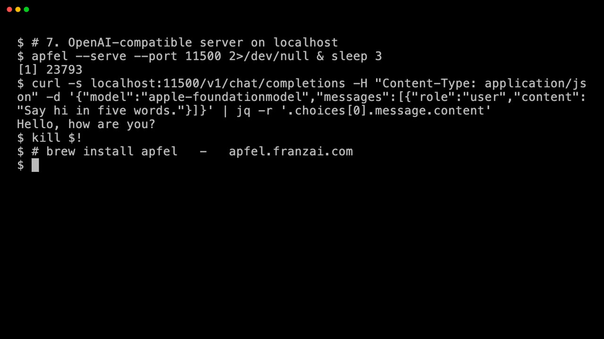

<!-- i18n-source: 456189202748709f4afd193b0fb6c49c6fd36c3c -->

> Oversatt fra den [engelske README-en](../README.md). Den engelske versjonen er den gjeldende.

# apfel

### Den gratis KI-en som allerede er på Macen din.

[](https://swift.org)
[](https://developer.apple.com/macos/)
[](https://developer.apple.com/xcode/resources/)
[](../LICENSE)
[](https://developer.apple.com/documentation/foundationmodels)
[](https://apfel.franzai.com)
[](../README.md#contributing)

Mac-maskiner med Apple Silicon leveres med en innebygd LLM via [Apple FoundationModels](https://developer.apple.com/documentation/foundationmodels). `apfel` gjør den tilgjengelig som et UNIX-verktøy og en lokal OpenAI-kompatibel server. 100 % på enheten. Ingen API-nøkler, ingen sky.

| Modus | Kommando | Hva du får |
|------|---------|--------------|
| UNIX-verktøy | `apfel "prompt"` / `echo "text" \| apfel` | Svar som fungerer med pipes, filvedlegg, JSON-utdata, avslutningskoder |
| OpenAI-kompatibel server | `apfel --serve` | Lokal `http://localhost:11434/v1`-backend som kan byttes rett inn for OpenAI SDK-er |

`apfel --chat` - interaktiv REPL.

[](https://apfel.franzai.com/nb/a/apfel-ai-tutorial/#video)

Verktøykall fungerer i alle sammenhenger.


## Krav og installasjon

macOS 26 Tahoe+, Apple Silicon (M1+), [Apple Intelligence aktivert](https://support.apple.com/en-us/121115). På macOS 27 kjører Mac-er med M3-brikke eller nyere og 12 GB+ Apples større modell på enheten med et vindu på 8192 tokens; M1/M2-Mac-er og alle Mac-er på macOS 26 har 4096. `apfel --model-info` viser hva din har.

```bash
brew install apfel
```

Oppdater:

```bash
brew upgrade apfel
```

Bygg fra kildekode (Command Line Tools med macOS 27 SDK / Swift 6.3, uten Xcode; binærfilen kjører på macOS 26 og 27):

```bash
git clone https://github.com/Arthur-Ficial/apfel.git && cd apfel && make install
```

Same-day tap, Mint, mise, feilsøking: [docs/install.md](../docs/install.md).

**Languages:** [English](../README.md) | [العربية](README.ar.md) | [Беларуская](README.be.md) | [Български](README.bg.md) | [বাংলা](README.bn.md) | [Bosanski](README.bs.md) | [Català](README.ca.md) | [Čeština](README.cs.md) | [Dansk](README.da.md) | [Deutsch](README.de.md) | [Ελληνικά](README.el.md) | [Español](README.es.md) | [Eesti](README.et.md) | [فارسی](README.fa.md) | [Suomi](README.fi.md) | [Français](README.fr.md) | [ગુજરાતી](README.gu.md) | [हिन्दी](README.hi.md) | [Hrvatski](README.hr.md) | [Magyar](README.hu.md) | [Italiano](README.it.md) | [日本語](README.ja.md) | [ಕನ್ನಡ](README.kn.md) | [한국어](README.ko.md) | [Lietuvių](README.lt.md) | [Latviešu](README.lv.md) | [Македонски](README.mk.md) | [മലയാളം](README.ml.md) | [मराठी](README.mr.md) | **Norsk bokmål** | [Nederlands](README.nl.md) | [Polski](README.pl.md) | [Português](README.pt.md) | [Română](README.ro.md) | [Русский](README.ru.md) | [Slovenčina](README.sk.md) | [Slovenščina](README.sl.md) | [Shqip](README.sq.md) | [Srpski](README.sr.md) | [Svenska](README.sv.md) | [தமிழ்](README.ta.md) | [తెలుగు](README.te.md) | [Türkçe](README.tr.md) | [Українська](README.uk.md) | [اردو](README.ur.md) | [简体中文](README.zh-hans.md) | [繁體中文](README.zh-hant.md)

## Hurtigstart

### UNIX-verktøy

Sett prompter som inneholder `!` i enkle anførselstegn (historikkutvidelse i zsh/bash): `apfel 'Hello, Mac!'`.

```bash
# Single prompt
apfel "What is the capital of Austria?"

# Permissive mode - reduces guardrail false positives for creative/long prompts
apfel --permissive "Write a dramatic opening for a thriller novel"

# Stream output
apfel --stream "Write a haiku about code"

# Pipe input
echo "Summarize: $(cat README.md)" | apfel

# Attach file content to prompt
apfel -f README.md "Summarize this project"

# Attach multiple files
apfel -f old.swift -f new.swift "What changed between these two files?"

# Attach a PDF or image - on-device text extraction, OCR, and "what the image is about"
apfel -f report.pdf "Summarize the key findings"
apfel -f receipt.jpg "What is the total?"

# Pipe a file straight in (PDF, image, or text)
cat report.pdf | apfel "Summarize this"

# Combine files with piped input
git diff HEAD~1 | apfel -f CONVENTIONS.md "Review this diff against our conventions"

# Only the code - no prose, no markdown fences (pipe-safe, exit 7 if empty)
apfel --code "a python function that deduplicates a list" > dedupe.py
apfel --code "shell one-liner to find the 10 largest files here" | pbcopy

# JSON output for scripting
apfel -o json "Translate to German: hello" | jq .content

# Guaranteed schema-valid JSON output (guided generation)
apfel --schema person.schema.json "Extract the person: Alice is 30." | jq .name

# One-shot multi-turn: conversation JSON in, next assistant turn out
jq '. += [{"role":"user","content":"and in German?"}]' conv.json | apfel --messages -

# Batch: JSONL records in, one JSON result line per record out (fresh session each)
jq -c '{custom_id:(.id|tostring),prompt:("Classify as billing, bug, or question: " + .text)}' tickets.jsonl \
  | apfel --batch | jq -c 'select(.status=="ok") | {id:.custom_id,category:.content}'

# Preflight token budget before a large prompt
apfel --count-tokens -f README.md "Summarize this"

# System prompt
apfel -s "You are a pirate" "What is recursion?"

# System prompt from file
apfel --system-file persona.txt "Explain TCP/IP"

# Quiet mode for shell scripts
result=$(apfel -q "Capital of France? One word.")
```

### OpenAI-kompatibel server

```bash
apfel --serve                              # foreground
brew services start apfel                  # background (like Ollama)
brew services stop apfel
APFEL_TOKEN=$(uuidgen) APFEL_MCP=/path/to/tools.py brew services start apfel
```

```bash
curl http://localhost:11434/v1/chat/completions \
  -H "Content-Type: application/json" \
  -d '{"model":"apple-foundationmodel","messages":[{"role":"user","content":"Hello"}]}'
```

```python
from openai import OpenAI
client = OpenAI(base_url="http://localhost:11434/v1", api_key="unused")
resp = client.chat.completions.create(
    model="apple-foundationmodel",
    messages=[{"role": "user", "content": "What is 1+1?"}],
)
print(resp.choices[0].message.content)
```

Detaljer om bakgrunnstjenesten: [docs/background-service.md](../docs/background-service.md).

### Chat for hurtigtesting

`apfel --chat` er en liten REPL for å teste prompter eller MCP-servere. For en chat-app med grafisk grensesnitt, se [apfel-chat](https://github.com/Arthur-Ficial/apfel-chat).

```bash
apfel --chat
apfel --chat -s "You are a helpful coding assistant"
apfel --chat --mcp ./mcp/calculator/server.py      # chat with MCP tools
apfel --chat --debug                                # debug output to stderr
```

Ctrl-C avslutter. Konteksten beskjæres automatisk ([docs/context-strategies.md](../docs/context-strategies.md)).

Begrensninger det er greit å kjenne til før du skriptar mot den (kontekstvindu per Mac, guardrails, ingen embeddings): [Begrensninger](../README.md#limitations).

## Demoer

Ekte shell-skript som bruker `apfel`: `cmd` (engelsk til shell-kommando), `oneliner`, `mac-narrator`, `wtd`, `explain`, `naming`, `port`, `gitsum`. De er innebygd i binærfilen - ingen kloning av repoet. Skriv dem ut der du installerte apfel fra (homebrew-core, tap-en eller kildekode):

```bash
apfel demos ./apfel-demos
```

Det skriver ut alle demoene (kjørbare) pluss en `README.md` i `./apfel-demos`. Kjør dem derfra:

```bash
./apfel-demos/cmd "find all .log files modified today"
# $ find . -name "*.log" -type f -mtime -1

./apfel-demos/cmd -x "show disk usage sorted by size"   # -x = execute after confirm
./apfel-demos/cmd -c "list open ports"                   # -c = copy to clipboard
```

Kjør `apfel demos` på nytt etter `brew upgrade apfel` for å oppdatere. Kildekode: [`demo/`](../demo/). Gjennomganger og en `cmd`-shell-funksjon du kan kopiere inn i `.zshrc`: [docs/demos.md](../docs/demos.md).

## MCP-verktøystøtte

Koble til [Model Context Protocol](https://modelcontextprotocol.io/)-servere med `--mcp`. apfel oppdager, kaller og returnerer.

```bash
apfel --mcp ./mcp/calculator/server.py "What is 15 times 27?"
```

```
mcp: ./mcp/calculator/server.py - add, subtract, multiply, divide, sqrt, power, round_number    ← stderr
tool: multiply({"a": 15, "b": 27}) = 405                                          ← stderr
15 times 27 is 405.                                                                ← stdout
```

Bruk `-q` for å skjule verktøyinfo.

```bash
apfel --mcp ./server_a.py --mcp ./server_b.py "Use both tools"
apfel --serve --mcp ./mcp/calculator/server.py
apfel --chat --mcp ./mcp/calculator/server.py
```

Leveres med en kalkulator i [`mcp/calculator/`](../mcp/calculator/) ([docs/mcp-calculator.md](../docs/mcp-calculator.md)).

**Eksterne MCP-servere** (Streamable HTTP, MCP-spesifikasjon 2025-03-26):

```bash
apfel --mcp https://mcp.example.com/v1 "what tools do you have?"

# bearer token - prefer env var (flag is visible in ps aux)
APFEL_MCP_TOKEN=mytoken apfel --mcp https://mcp.example.com/v1 "..."

# mixed local + remote
apfel --mcp /path/to/local.py --mcp https://remote.example.com/v1 "..."
```

> **Sikkerhet:** bruk helst `APFEL_MCP_TOKEN` fremfor `--mcp-token` (ps aux). apfel nekter bearer-tokens over ukryptert `http://`.

## apfel-run: valgfritt konfigurasjonslag

apfel selv har ingen konfigurasjonsfil - flagg + miljøvariabler, som ethvert UNIX-verktøy. Hvis du vil ha en TOML-konfigurasjon (mange MCP-er, profiler, teamkonfigurasjoner i git), er [**apfel-run**](https://github.com/Arthur-Ficial/apfel-run) en MIT-lisensiert wrapper som legger til dette via en `execve`-erstatning.

```bash
brew install Arthur-Ficial/tap/apfel-run
apfel-run config init                 # starter ~/.config/apfel/config.toml
alias apfel=apfel-run                 # optional, every apfel flag still works
```

## OpenAI API-kompatibilitet

**Base-URL:** `http://localhost:11434/v1`

| Funksjon | Status | Merknader |
|---------|--------|-------|
| `POST /v1/chat/completions` | Støttet | Streaming + uten streaming |
| `POST /v1/responses` | Støttet | OpenAI Responses API: streng-/meldingsinput, `instructions`, streaming (kanonisk hendelsesrekkefølge), `text.format` (inkl. `json_schema`), funksjonsverktøy (uten streaming). Tilstandsfulle funksjoner (`previous_response_id`, `store: true`, `background`, `reasoning`, hostede verktøy) gir ærlige 501-svar |
| `POST /v1/responses/input_tokens` | Støttet | Token-forhåndssjekk (`client.responses.input_tokens.count(...)`): eksakt antall fra Apples tokenizer, ingen generering; 501 under macOS 26.4 i stedet for et estimat. Se [docs/openai-api-compatibility.md](../docs/openai-api-compatibility.md#token-preflight-v1responsesinput_tokens) |
| `GET /v1/models` | Støttet | Returnerer `apple-foundationmodel` (generell, standard) og `apple-foundationmodel-content-tagging` (etiketter, ikke prosa). Se [docs/openai-api-compatibility.md](../docs/openai-api-compatibility.md#content-tagging-model) |
| `GET /health` | Støttet | Modelltilgjengelighet, kontekstvindu, språk, rapporterte modellegenskaper (`capabilities`, `capabilities_reported`), modellvarianten som betjener (`variant`, f.eks. AFM 3 Core) |
| `GET /v1/logs`, `/v1/logs/stats` | Kun feilsøking | Krever `--debug` |
| Verktøykall | Støttet | Kallet skrives med styrt generering (`--tool-calling guided`, standard) eller som JSON som serveren parser (`--tool-calling text`). Se [docs/tool-calling-guide.md](../docs/tool-calling-guide.md) |
| `response_format: json_object` | Støttet | Injeksjon i systemprompten; markdown-gjerder fjernes fra utdata |
| `response_format: json_schema` | Støttet | Garantert skjemakonform utdata via FoundationModels `DynamicGenerationSchema`; fungerer med `stream: true` |
| `temperature`, `top_p`, `max_tokens`, `seed` | Støttet | Tilordnet til `GenerationOptions`. `top_p` er nucleus sampling; `temperature` under 0.001 (0 inkludert) tilordnes greedy (deterministisk). Utelates `max_tokens`, brukes resten av kontekstvinduet (OpenAI-semantikk som drop-in) - se [Standard svargrense](../README.md#default-response-cap-max_tokens) |
| `stream: true` | Støttet | SSE; siste usage-chunk kun når `stream_options: {"include_usage": true}` (iht. OpenAI-spesifikasjonen) |
| `usage` | Støttet | Reelle tokenizer-tall på macOS 26.4+ (estimat på tegn/4 under det). macOS 27: kjøretidens egen telling inkl. Apples chat-mal-rammer (omtrent 46 ekstra `prompt_tokens` på en enlinjes prompt); macOS 26: apfel teller meldingsteksten. Detaljer i [docs/openai-api-compatibility.md](../docs/openai-api-compatibility.md) |
| `finish_reason` | Støttet | `stop`, `tool_calls`, `length` |
| Kontekststrategier | Støttet | Utvidelsesfeltene `x_context_strategy`, `x_context_max_turns`, `x_context_output_reserve` |
| CORS | Støttet | Aktiveres med `--cors` |
| `POST /v1/completions` | 501 | Eldre tekstfullføring støttes ikke |
| `POST /v1/embeddings` | 501 | Embeddings er ikke tilgjengelig på enheten |
| `stop` | Støttet | Én streng eller opptil 4 strenger; kun ren tekst (400 med verktøy i bruk eller `json_object`/`json_schema`). Brukes på utdata-siden, likt med og uten streaming. Se [docs/openai-api-compatibility.md](../docs/openai-api-compatibility.md#stop-sequences) |
| `logprobs=true`, `n>1`, `presence_penalty`, `frequency_penalty` | 400 | Avvises eksplisitt. `n=1` og `logprobs=false` godtas som no-ops |
| Multimodal (bilder) | Støttet på macOS 27 | `image_url`-deler som base64-data-URL-er går direkte til modellen på enheten (grense på 20 MB base64, lengste side nedskalert til 4096 px). Eksterne `http(s)`-URL-er og filstier gir alltid 400 - apfel henter aldri bilder og leser aldri filer for en HTTP-klient. På macOS 26: 400 med en tydelig feilmelding. Se [docs/openai-api-compatibility.md](../docs/openai-api-compatibility.md) |
| `Authorization`-header | Støttet | Kreves når `--token` er satt. Se [docs/server-security.md](../docs/server-security.md) |

Full API-spesifikasjon: [openai/openai-openapi](https://github.com/openai/openai-openapi).

## Standard svargrense (`max_tokens`)

Når `max_tokens` utelates, **oppfører CLI og den OpenAI-kompatible serveren seg likt**: verdien sendes videre som `nil`, og modellen bruker det som er igjen i kontekstvinduet. Dette er OpenAI-semantikk som drop-in - ingen vilkårlig reservekonstant.

Kontekstvinduet på enheten rommer input *og* output til sammen: **4096 tokens på macOS 26 og på M1/M2-Mac-er, 8192 tokens på macOS 27 med M3-brikke eller nyere og 12 GB+**. apfel leser den faktiske størrelsen ved kjøretid via `SystemLanguageModel.contextSize` - sjekk din med `apfel --model-info`. Hvis genereringen når taket, avsluttes svaret rent med `finish_reason: "length"`, og det delvise innholdet returneres (server: HTTP 200; CLI: exit 0 med en stderr-advarsel, eller exit 8 med `--require-complete` - se [docs/cli-reference.md](../docs/cli-reference.md)). Angi `max_tokens` eksplisitt når du vil ha et strammere latensbudsjett eller en kjent grense for klienten din.

### Eksempler

```bash
# Omitted: uses remaining window, finish_reason: "stop" or "length"
curl -sS http://localhost:11434/v1/chat/completions \
  -H "Content-Type: application/json" \
  -d '{"model":"apple-foundationmodel",
       "messages":[{"role":"user","content":"Reply SKIP, MOVE, or RENAME."}]}'

# Explicit cap (recommended for tight latency budgets)
curl -sS http://localhost:11434/v1/chat/completions \
  -H "Content-Type: application/json" \
  -d '{"model":"apple-foundationmodel","max_tokens":128,
       "messages":[{"role":"user","content":"Summarise: ..."}]}'
```

### Velge en verdi

| Bruksområde                            | `max_tokens`  |
|----------------------------------------|---------------|
| Enkeltordssvar / klassifisering        | 16 - 32       |
| Én linje instruksjon                   | 64 - 128      |
| Kort avsnitt                           | 256 - 512     |
| Langt avsnitt / strukturert JSON       | 1024 - 2048   |
| Så langt kontekstvinduet tillater      | utelat den    |

Hold `input_tokens + max_tokens` komfortabelt under kontekstvinduet (4096 tokens på macOS 26 og på M1/M2-Mac-er, 8192 på macOS 27 med M3-brikke eller nyere og 12 GB+ (Apples AFM 3 Core Advanced-modell)). Hvis selve prompten overskrider vinduet, kan ikke genereringen starte, og forespørselen feiler med `[context overflow]` (HTTP 400 / CLI exit 4). Valideringen avviser verdier som ikke er positive (`max_tokens <= 0`).

### CLI-paritet

CLI og server deler én regel: utelatt = bruk resten av vinduet. Ingen konstant som kan drifte. Overstyr med `--max-tokens N` eller `APFEL_MAX_TOKENS=N`.

```bash
apfel "Reply SKIP."                    # uses remaining window
apfel --max-tokens 64 "Reply SKIP."    # explicit cap
APFEL_MAX_TOKENS=2048 apfel "..."      # via env var
```

### Tillatende guardrails for serveren

`apfel --serve --permissive` får serveren til å bruke Apples `.permissiveContentTransformations`-guardrails for **hver forespørsel** prosessen håndterer. Samme flagg, samme semantikk som CLI-ets `--permissive` ([docs/PERMISSIVE.md](../docs/PERMISSIVE.md)). Det finnes ingen overstyring per forespørsel - serveroperatøren bestemmer for hele prosessen.

```bash
apfel --serve --permissive             # every request uses permissive guardrails
```

## Begrensninger

| Begrensning | Detalj |
|------------|--------|
| Kontekstvindu | **4096 tokens på macOS 26 og på M1/M2-Mac-er, 8192 tokens på macOS 27 med M3-brikke eller nyere og 12 GB+** (input + output til sammen). Ikke en hardkodet konstant - apfel leser `SystemLanguageModel.contextSize` ved kjøretid; `apfel --model-info` skriver ut den gjeldende verdien |
| Plattform | macOS 26+, kun Apple Silicon |
| Modell | Én modell på enheten (~3B parametere), tilgjengelig som `apple-foundationmodel` (generell) og `apple-foundationmodel-content-tagging` (Apples adapter for innholdsmerking; ingen verktøy) |
| Guardrails | Apples sikkerhetssystem kan blokkere harmløse prompter. `--permissive` reduserer falske positive ([docs/PERMISSIVE.md](../docs/PERMISSIVE.md)) |
| Hastighet | På enheten, ikke i skyskala - noen sekunder per svar |
| Ingen embeddings | Ikke tilgjengelig på enheten |
| Vision | Bildeinput når modellen kun på macOS 27 (server: data-URL-er; CLI: `-f photo.jpg` og bilder via pipe, i tillegg til OCR-teksten). På macOS 26 er bilder kun tekst via OCR/klassifisering. Den 3B-modellens scenebeskrivelser er grove - OCR er fortsatt den pålitelige kanalen for å lese trykt tekst |
| Treningsdata / kunnskapsgrense | Apple har ikke publisert en presis kunnskapsgrense for modellen på enheten. Når den presses til å oppgi en, **dikter modellen opp en ny dato for hver prøve** (f.eks. "October 2023", "April 2023"). Behandle alle modellens egne utsagn om egen trening som upålitelige. |
| Ingen gjeldende dato eller sanntidsbevissthet | Modellen kjenner ikke dagens dato og har ingen nettverks- eller klokketilgang. Hvis du spør, vil den enten nekte eller finne på en dato. Legg inn dagens dato via systemprompten når utregninger avhenger av den (se omgåelsen nedenfor). |

**Omgåelse for datoavhengige prompter** - legg inn dagens dato som en systemmelding:

```bash
apfel -s "Today is $(date '+%B %d, %Y')." "Write a one-line release note dated today."
```

```bash
apfel --chat -s "Today is $(date '+%B %d, %Y'). You are a helpful assistant."
```

Merk: selv med en innlagt dato kan 3B-modellen fortsatt hallusinere (særlig når den spørres direkte om sin egen treningsgrense). Innleggingen hjelper generative prompter som *bruker* datoen; den overstyrer ikke modellens refleks til å svare om seg selv.

Bakgrunn: [#158](https://github.com/Arthur-Ficial/apfel/issues/158).

## Referansedokumenter

Guider for å bruke apfel fra [Python](../docs/guides/python.md), [Node.js](../docs/guides/nodejs.md), [Ruby](../docs/guides/ruby.md), [PHP](../docs/guides/php.md), [Bash/curl](../docs/guides/bash-curl.md), [Zsh](../docs/guides/zsh.md), [AppleScript](../docs/guides/applescript.md), [Swift](../docs/guides/swift-scripting.md), [Perl](../docs/guides/perl.md), [AWK](../docs/guides/awk.md) - se [docs/guides/index.md](../docs/guides/index.md). Empirisk testet; kjørbart bevis på [apfel-guides-lab](https://github.com/Arthur-Ficial/apfel-guides-lab).

- [docs/install.md](../docs/install.md) - installasjon, feilsøking og oppsett av Apple Intelligence
- [docs/cli-reference.md](../docs/cli-reference.md) - alle flagg, avslutningskoder og miljøvariabler
- [docs/file-extraction.md](../docs/file-extraction.md) - `-f` og uttrekk av PDF / bilde / tekst via pipe (OCR + bildeforståelse)
- [docs/background-service.md](../docs/background-service.md) - bruk av `brew services` og launchd
- [docs/openai-api-compatibility.md](../docs/openai-api-compatibility.md) - støttematrisen for `/v1/*` i dybden
- [docs/server-security.md](../docs/server-security.md) - opprinnelseskontroller, CORS, tokens og `--footgun`
- [docs/context-strategies.md](../docs/context-strategies.md) - strategier for beskjæring i chat
- [docs/mcp-calculator.md](../docs/mcp-calculator.md) - lokal og ekstern MCP-bruk
- [docs/tool-calling-guide.md](../docs/tool-calling-guide.md) - detaljert oppførsel for verktøykall
- [docs/integrations.md](../docs/integrations.md) - integrasjoner med tredjepartsverktøy (opencode osv.)
- [docs/local-setup-with-vs-code.md](../docs/local-setup-with-vs-code.md) - lokal gjennomgang med apfel + en andre edit/apply-modell i VS Code
- [docs/demos.md](../docs/demos.md) - lengre gjennomganger av shell-demoene
- [docs/EXAMPLES.md](../docs/EXAMPLES.md) - 50+ ekte prompter med uredigert utdata
- [docs/swift-library.md](../docs/swift-library.md) - Swift-pakken `ApfelCore` for utviklere nedstrøms
- [docs/coreai-impact.md](../docs/coreai-impact.md) - hvorfor apfel kjører på FoundationModels, ikke Apples nye Core AI (etterfølgeren til Core ML)
- [docs/apfel-vs-fm.md](../docs/apfel-vs-fm.md) - apfel sammenlignet med Apples egen `fm` CLI (macOS 27), funksjon for funksjon med målte tall

## Arkitektur

```text
CLI (single/stream/chat) ──┐
                           ├─→ FoundationModels.SystemLanguageModel
HTTP Server (/v1/*) ───────┘   (100% on-device, zero network)
                                ContextManager → Transcript API
                                SchemaConverter → native ToolDefinitions
                                TokenCounter → real token counts (SDK 26.4)
```

Swift 6.3 strict concurrency. Tre targets: `ApfelCore` (ren logikk, enhetstestbar, også tilgjengelig som Swift Package-produkt - lenket under Referansedokumenter ovenfor), `apfel` (CLI + server) og `apfel-tests` (ren Swift-runner, uten XCTest).

## Bygg og test

```bash
make test                                # release build + all unit/integration tests
make preflight                           # full release qualification
make install                             # build release + install to /usr/local/bin
make build                               # build release only
make version                             # print current version
make release                             # patch release
make release TYPE=minor                  # minor release
make release TYPE=major                  # major release
swift build                              # quick debug build (no version bump)
swift run apfel-tests                    # unit tests
python3 -m pytest Tests/integration/ -v  # integration tests
apfel --benchmark -o json                # performance report
```

`.version` er den eneste sannhetskilden. Kun `make release` øker versjonsnumre. Lokale bygg endrer ikke versjonen.

## apfel-treet

Prosjekter bygget på apfel. Hvert av dem leveres som eget repo + Homebrew-formel.

| Prosjekt | Hva det gjør | Installasjon |
|---------|--------------|---------|
| [**apfel**](https://apfel.franzai.com) | Roten. FoundationModels-CLI på enheten + OpenAI-kompatibel server. | `brew install apfel` |
| [**apfel-chat**](https://apfel-chat.franzai.com) | macOS-chatklient: streaming markdown, tale inn/ut, bildeanalyse med Apple Vision. | `brew install Arthur-Ficial/tap/apfel-chat` |
| [**apfel-clip**](https://apfel-clip.franzai.com) | KI-handlinger i menylinjen på utklippstavlen: oppsummer, oversett, skriv om. | `brew install Arthur-Ficial/tap/apfel-clip` |
| [**apfel-quick**](https://apfel-quick.franzai.com) | Rask KI-overlegg: trykk en tast, spør, få svar, lukk. | `brew install Arthur-Ficial/tap/apfel-quick` |
| [**apfelpad**](https://apfelpad.franzai.com) | Formelnotatblokk - KI på enheten som en innebygd cellefunksjon. | `brew install Arthur-Ficial/tap/apfelpad` |
| [**apfel-mcp**](https://apfel-mcp.franzai.com) | MCP-er optimalisert for tokenbudsjett i det lille vinduet på enheten: `url-fetch`, `ddg-search`, `search-and-fetch`. | `brew install Arthur-Ficial/tap/apfel-mcp` |
| [**apfel-gui**](https://github.com/Arthur-Ficial/apfel-gui) | SwiftUI-inspektør for feilsøking: tidslinje for forespørsler, MCP-protokollvisning, TTS/STT. | `brew install Arthur-Ficial/tap/apfel-gui` |
| [**apfel-run**](https://github.com/Arthur-Ficial/apfel-run) | UNIX-wrapper som legger til et vedvarende MCP-register + TOML-konfigurasjon oppå `apfel`. | `brew install Arthur-Ficial/tap/apfel-run` |
| [**apfel-tag**](https://github.com/Arthur-Ficial/apfel-tag) | CLI for innholdstagging på enheten: send tekst inn, få tagger/temaer/følelser ut. | `brew install Arthur-Ficial/tap/apfel-tag` |
| [**apfel-server-kit**](https://github.com/Arthur-Ficial/apfel-server-kit) | Swift-pakke for økosystemverktøy: finn, start og strøm fra en lokal `apfel --serve`. | Swift Package |

## Fellesskapsprosjekter

Har du bygget noe oppå apfel? Åpne en issue, så kan det bli lagt til her.

| Prosjekt | Hva det gjør | Lenker |
|---------|-------------|-------|
| **apfelclaw** av [@julianYaman](https://github.com/julianYaman) | Lokal KI-agent som leser filer, kalender, e-post og Mac-status via skrivebeskyttede verktøy | [github](https://github.com/julianyaman/apfelclaw) - [site](https://apfelclaw.yamanlabs.com/) |
| **fruit-chat** av [@bhaskarvilles](https://github.com/bhaskarvilles) | Nettleserbasert chat-grensesnitt som snakker med `apfel --serve` via det OpenAI-kompatible API-et | [github](https://github.com/bhaskarvilles/fruit-chat) |
| **local-claude** av [@lucaspwo](https://github.com/lucaspwo) | Claude Code-wrapper som bytter inn apfel som lokal backend via en liten Anthropic-OpenAI-proxy | [github](https://github.com/lucaspwo/local-claude) |
| **apfeller** av [@hasit](https://github.com/hasit) | Appbehandler for lokale shell-apper bygget rundt apfel | [github](https://github.com/hasit/apfeller) - [site](https://hasit.github.io/apfeller/) - [catalog](https://hasit.github.io/apfeller/catalog/) |
| **apfel-for-raycast** av [@eggsy](https://github.com/eggsy) | Raycast-utvidelse for kommandolinjen: spør, oversett, forklar filer og kataloger, samtalehistorikk, egne systemprompter. På enheten via apfel CLI. | [store](https://www.raycast.com/eggsy/apfel) - [github](https://github.com/raycast/extensions/tree/main/extensions/apfel) |

## Bidra

Issues og PR-er er velkomne i alle `Arthur-Ficial/apfel*`-repoer.

**#agentswelcome** - PR-er fra KI-agenter er greit. Les repoets `CLAUDE.md`, kjør testene, og krediter verktøyet i en `Co-Authored-By`-trailer. Samme krav som for mennesker: ren kode, beståtte tester, ærlige begrensninger. Det mest agentvennlige startpunktet: [apfel-mcp](https://github.com/Arthur-Ficial/apfel-mcp) ([bidragsregler](https://apfel-mcp.franzai.com/#contribute)).

## Lisens

[MIT](../LICENSE)
